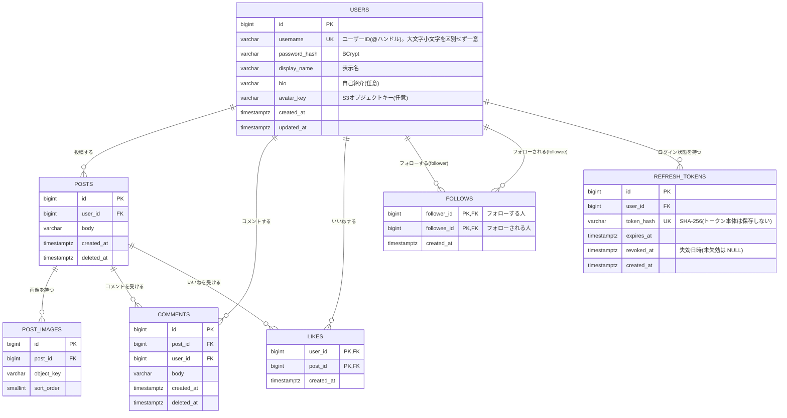

# 04. ER図・テーブル定義(PostgreSQL 17)

要件定義書([01-requirements.md](01-requirements.md))7章の補足資料です。テーブルは Flyway のマイグレーションで管理します。

## 1. ER図


## 2. テーブル定義

### users
| カラム | 型 | NULL | 制約 | 説明 |
|---|---|---|---|---|
| id | BIGINT GENERATED ALWAYS AS IDENTITY | NO | PK | ユーザーの識別子(内部ID) |
| username | VARCHAR(15) | NO | UNIQUE INDEX on `lower(username)` | ユーザーID(@ハンドル)。3〜15文字、半角英数字と `_`。**大文字小文字を区別せず重複不可**。ログインにも使う。入力時の表記は保持する |
| password_hash | VARCHAR(255) | NO | | BCrypt ハッシュ |
| display_name | VARCHAR(30) | NO | | 表示名(重複可) |
| bio | VARCHAR(160) | YES | | 自己紹介 |
| avatar_key | VARCHAR(255) | YES | | アイコン画像の S3 オブジェクトキー |
| created_at | TIMESTAMPTZ | NO | DEFAULT now() | 登録日時 |
| updated_at | TIMESTAMPTZ | NO | DEFAULT now() | 更新日時 |

検索用インデックス(F-SEARCH):
```sql
CREATE EXTENSION IF NOT EXISTS pg_trgm;
CREATE INDEX idx_users_username_trgm     ON users USING gin (lower(username)     gin_trgm_ops);
CREATE INDEX idx_users_display_name_trgm ON users USING gin (lower(display_name) gin_trgm_ops);
```
`ILIKE '%キーワード%'` の部分一致をインデックスで高速化するためです。

### refresh_tokens
リフレッシュトークン(F-AUTH)。ログインのたびに 1 行作り、リフレッシュのたびに新しい行へ置き換える(ローテーション)。
| カラム | 型 | NULL | 制約 | 説明 |
|---|---|---|---|---|
| id | BIGINT GENERATED ALWAYS AS IDENTITY | NO | PK | |
| user_id | BIGINT | NO | FK → users.id, `ON DELETE CASCADE` | 持ち主 |
| token_hash | VARCHAR(64) | NO | UNIQUE | トークンの SHA-256(16 進)。**トークン本体は保存しない** |
| expires_at | TIMESTAMPTZ | NO | | 有効期限(発行から 7 日) |
| revoked_at | TIMESTAMPTZ | YES | | 失効日時。ローテーション・ログアウト・盗難検知で設定 |
| created_at | TIMESTAMPTZ | NO | DEFAULT now() | 発行日時 |

- `user_id` にインデックス(全失効・期限切れ削除用)。
- 期限切れの行は、そのユーザーのリフレッシュ時に削除する(定期ジョブは使わない)。

### posts
| カラム | 型 | NULL | 制約 | 説明 |
|---|---|---|---|---|
| id | BIGINT GENERATED ALWAYS AS IDENTITY | NO | PK | 投稿ID |
| user_id | BIGINT | NO | FK → users.id | 投稿者 |
| body | VARCHAR(280) | NO | | 本文(1〜280文字) |
| created_at | TIMESTAMPTZ | NO | DEFAULT now() | 投稿日時 |
| updated_at | TIMESTAMPTZ | NO | DEFAULT now() | 最終更新日時(編集時に更新。`created_at` より後なら「編集済み」) |
| deleted_at | TIMESTAMPTZ | YES | | 論理削除日時 |

```sql
-- 全体タイムライン(新しい順・カーソル方式)
CREATE INDEX idx_posts_timeline ON posts (created_at DESC, id DESC) WHERE deleted_at IS NULL;
-- プロフィール・フォロー中タイムライン(投稿者で絞り込み)
CREATE INDEX idx_posts_user     ON posts (user_id, created_at DESC, id DESC) WHERE deleted_at IS NULL;
```

### post_images
| カラム | 型 | NULL | 制約 | 説明 |
|---|---|---|---|---|
| id | BIGINT GENERATED ALWAYS AS IDENTITY | NO | PK | 画像ID |
| post_id | BIGINT | NO | FK → posts.id, UNIQUE(post_id, sort_order) | 対象投稿 |
| object_key | VARCHAR(255) | NO | | S3 オブジェクトキー(例: `posts/{userId}/{uuid}.jpg`) |
| sort_order | SMALLINT | NO | CHECK (sort_order BETWEEN 0 AND 3) | 表示順 |

### comments
| カラム | 型 | NULL | 制約 | 説明 |
|---|---|---|---|---|
| id | BIGINT GENERATED ALWAYS AS IDENTITY | NO | PK | コメントID |
| post_id | BIGINT | NO | FK → posts.id | 対象投稿 |
| user_id | BIGINT | NO | FK → users.id | コメント者 |
| body | VARCHAR(280) | NO | | 本文(1〜280文字) |
| created_at | TIMESTAMPTZ | NO | DEFAULT now() | コメント日時 |
| deleted_at | TIMESTAMPTZ | YES | | 論理削除日時 |

```sql
CREATE INDEX idx_comments_post ON comments (post_id, created_at, id) WHERE deleted_at IS NULL;
```

### likes
| カラム | 型 | NULL | 制約 | 説明 |
|---|---|---|---|---|
| user_id | BIGINT | NO | PK(複合), FK → users.id | いいねしたユーザー |
| post_id | BIGINT | NO | PK(複合), FK → posts.id | 対象投稿 |
| created_at | TIMESTAMPTZ | NO | DEFAULT now() | いいね日時 |

`CREATE INDEX idx_likes_post ON likes (post_id);` 複合主キーで「1ユーザー1投稿1回」を DB で保証。登録は `INSERT ... ON CONFLICT DO NOTHING` で冪等にする。

### follows
| カラム | 型 | NULL | 制約 | 説明 |
|---|---|---|---|---|
| follower_id | BIGINT | NO | PK(複合), FK → users.id | フォローする人 |
| followee_id | BIGINT | NO | PK(複合), FK → users.id | フォローされる人 |
| created_at | TIMESTAMPTZ | NO | DEFAULT now() | フォロー日時 |

- `CHECK (follower_id <> followee_id)` で自分自身のフォローを DB でも禁止。
- 主キー `(follower_id, followee_id)` で「自分がフォローしている人」を引く。`CREATE INDEX idx_follows_followee ON follows (followee_id, created_at DESC);` で「フォロワー一覧」を引く。
- 登録は `INSERT ... ON CONFLICT DO NOTHING`、解除は `DELETE`。どちらも冪等。
- ユーザー削除機能は今回なし(将来追加時は `ON DELETE CASCADE` を検討)。

## 3. 主なクエリの方針
| 用途 | 方針 |
|---|---|
| 全体タイムライン | `posts` を `(created_at, id)` の降順でカーソル取得(`deleted_at IS NULL`) |
| フォロー中タイムライン | `WHERE user_id = :me OR user_id IN (SELECT followee_id FROM follows WHERE follower_id = :me)` を同じ並びで取得 |
| 件数(いいね・コメント) | 取得した投稿ID群に対し `GROUP BY post_id` でまとめて集計し、N+1 を避ける。自分のいいね済みは `EXISTS` |
| フォロー数・フォロワー数 | `COUNT(*) FROM follows WHERE follower_id = ? / followee_id = ?`。プロフィール表示時に取得 |
| ユーザー検索 | `lower(username) LIKE :q OR lower(display_name) LIKE :q`(`:q` は `%キーワード%`、`%` `_` はエスケープ)。自分を除外し、`username` 昇順 |
| フォロー済み判定 | 検索結果・プロフィールの対象ユーザーID群に対し `follows` を `IN` で一括照会 |

規模が大きくなった場合は、`posts` / `users` に `like_count` / `comment_count` / `follower_count` などを非正規化して持つ案を検討する(発展課題)。

## 4. 画像の保存方針(S3)
- バケットは非公開。DB には `object_key` / `avatar_key` のみ保存し、URL は保存しない。
- アップロード: フロント → バックエンドに署名付き PUT URL を要求(形式・サイズ検証) → ブラウザが S3 へ直接 PUT → 投稿/プロフィール更新 API にキーを送信。
- 表示: バックエンドがキーから署名付き GET URL(短い有効期限)を生成して API レスポンスに含める。
- 投稿削除は論理削除のため、S3 上のオブジェクトの削除は後続バッチで行う(今回は対象外)。
- 構成は [05-infrastructure.md](05-infrastructure.md) を参照。

## 5. 設計メモ
- **インプレッション数用のカラム/テーブルは作らない**(差別化方針)。
- **リポスト用のテーブル/カラムは作らない**。
- 投稿削除時は `posts.deleted_at` をセットし、コメント・いいね・画像は参照側で投稿の削除状態を見て非表示にする(BR-06)。
- フォローは承認制なし。ブロック・ミュート用のテーブルは作らない(対象外)。
