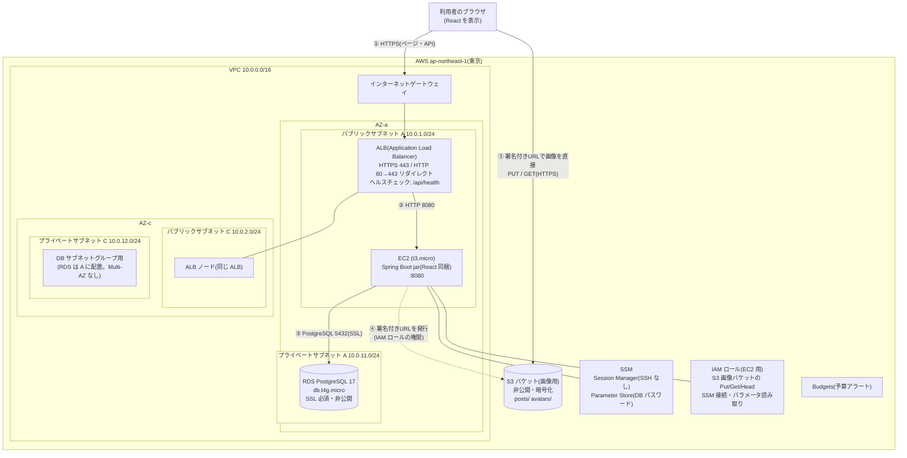
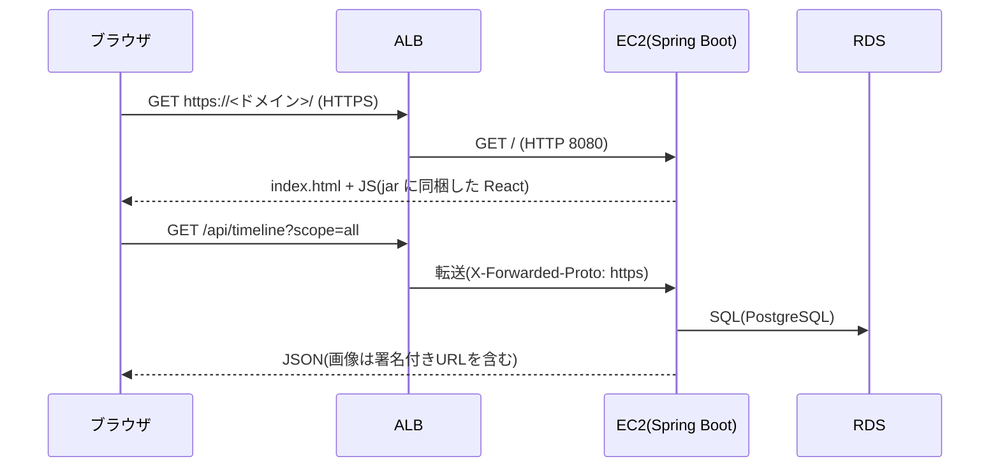

# 05. インフラ構成図(AWS)

要件定義書([01-requirements.md](01-requirements.md))6.2・10.3 の補足資料です。**AWS 上にサーバーを構築するかはまだ決まっていません**。決まった時に迷わないよう、前提とする構成(EC2 + RDS + ALB + S3)を先に図にしたものです。構築コード(Terraform 等)は含みません。

TaskManagement の AWS 構成([../../TaskManagment/docs/aws-deploy-guide.md](../../TaskManagment/docs/aws-deploy-guide.md))をベースに、**ALB と画像用 S3 を追加**し、**RDS を 2AZ のプライベートサブネットに置く**形にしています。

## 1. 全体構成図

| 番号 | 通信 | 内容 |
|---|---|---|
| ① | ブラウザ → ALB | ページ(React の静的ファイル)と `/api/*` の両方。ALB で TLS を終端する |
| ② | ALB → EC2 | 8080 番へ転送。ターゲットグループのヘルスチェックは `GET /api/health`(200) |
| ③ | EC2 → RDS | 5432 番。SSL 必須(`sslmode=require`)。DB はインターネットから届かない |
| ④ | EC2 → S3 | アプリが署名付き URL を生成する(署名はローカル計算)。投稿作成時の存在確認(`HeadObject`)のみ実際に S3 へ通信 |
| ⑤ | ブラウザ → S3 | **画像本体は EC2 を経由しない**。ブラウザが署名付き URL で S3 へ直接アップロード/取得する |

## 2. リクエストの流れ
### 2.1 ページ表示・API

### 2.2 画像のアップロード
詳細なシーケンスは [features/F-POST.md](features/F-POST.md) の 4 章を参照。

## 3. ネットワークとセキュリティグループ

| セキュリティグループ | 受信(許可) | 送信 | 備考 |
|---|---|---|---|
| alb-sg | 443(HTTPS)・80(HTTP→HTTPS リダイレクト)。接続元は `0.0.0.0/0`(絞る場合は `allowed_cidrs` 方式) | app-sg の 8080 | 利用者の入口 |
| app-sg(EC2) | **8080 は alb-sg からのみ**。SSH(22)は開けない | 全て許可(RDS・S3・SSM・パッケージ取得) | 操作は SSM Session Manager |
| db-sg(RDS) | **5432 は app-sg からのみ** | なし | パブリックアクセス無効 |

- **NAT Gateway は置かない**(常時課金のため)。EC2 はパブリックサブネットに置き、パブリック IP でインターネット(S3・SSM・パッケージ取得)へ出る。ただし受信は app-sg で ALB に限定されるため、外部から直接は入れない。
- RDS は DB サブネットグループに **2 つの AZ のサブネット**を登録する(RDS の仕様上必須)。実体は片方の AZ に作る(Multi-AZ なし)。
- S3 へは、無料の **S3 ゲートウェイ VPC エンドポイント**を付けると、S3 との通信が AWS 内部で完結する(任意)。
- TaskManagement はデフォルト VPC を使っている。同じようにデフォルト VPC で始めてもよい(その場合、サブネットを新規作成せず、既存の複数 AZ のサブネットを使う)。

## 4. S3(画像用バケット)

| 項目 | 設定 |
|---|---|
| パブリックアクセス | すべてブロック(ブロックパブリックアクセス ON)。バケットポリシーで公開しない |
| 暗号化 | SSE-S3(既定) |
| キーの構成 | `posts/{userId}/{uuid}.{ext}`(投稿画像)/ `avatars/{userId}/{uuid}.{ext}`(アイコン) |
| アクセス方法 | 署名付き URL のみ。PUT は有効期限 5 分、GET は短時間(例: 15 分) |
| CORS | 許可オリジン=アプリのドメイン(`https://<ドメイン>`)。メソッド=`PUT`・`GET`・`HEAD`。ヘッダー=`Content-Type`。`ExposeHeaders`=`ETag` |
| ライフサイクル | 拡張候補: 投稿に使われなかった未使用オブジェクトの自動削除 |
| TaskManagement の jar 用バケットとの関係 | **別バケット**にする(画像用は非公開・長期保存、jar 用は一時置き場) |

**EC2 用 IAM ロール**に付ける権限(最小限):
- 画像バケットの `s3:PutObject` / `s3:GetObject` / `s3:HeadObject` / `s3:DeleteObject`(削除は将来のバッチ用。必要になるまで付けなくてよい)
- SSM 接続(`AmazonSSMManagedInstanceCore`)と、DB パスワードの Parameter Store 読み取り

署名付き URL は、署名したロールの権限で有効になる。ロールに付けた権限を超える操作はできない。

## 5. アプリの設定(環境変数)

| 環境変数 | 値 | 理由 |
|---|---|---|
| `SPRING_DATASOURCE_URL` | `jdbc:postgresql://<RDS のホスト名>:5432/raisetimeline?sslmode=require` | RDS へ SSL で接続 |
| `DB_USER` / `DB_PASSWORD` / `DB_NAME` | Terraform 等で生成。パスワードは SSM Parameter Store に保管 | 認証情報をコードに置かない |
| `SERVER_ADDRESS` | `0.0.0.0` | ALB から届くようにする |
| `SERVER_FORWARD_HEADERS_STRATEGY` | `framework` | ALB が付ける `X-Forwarded-*` を信頼し、HTTPS と認識させる |
| `SERVER_SERVLET_SESSION_COOKIE_SECURE` | `true` | HTTPS のときだけ Cookie を送る |
| `APP_S3_BUCKET` / `AWS_REGION` | 画像用バケット名 / `ap-northeast-1` | 署名付き URL の発行先 |

## 6. 運用・費用

- 操作は **SSM Session Manager** で行う(SSH なし)。ログは EC2 上の Docker/アプリのログを確認する。
- **Budgets** で予算超過をメール通知する。
- 目安(東京リージョン・出しっぱなし)。数字は目安で、実際は [AWS 料金計算ツール](https://calculator.aws/)で確認する。

| 項目 | 目安(月) |
|---|---|
| EC2 t3.micro | 約 $10 |
| EBS 20GB | 約 $2 |
| RDS db.t4g.micro | 約 $19 |
| RDS ストレージ 20GB | 約 $3 |
| **ALB**(固定費+使用量) | **約 $18〜25** |
| パブリック IPv4(EC2・ALB が使う分) | 約 $3.6 × 使用数 |
| S3(数 GB) | 数十円〜 |
| 合計 | **約 $60 前後**(TaskManagement の約 $38 から、ALB 分が増える) |

ALB は**常時課金**。TaskManagement は費用面から ALB を使わない方針だったが、本アプリでは指定により採用する。使わない間は `terraform destroy` 等で全て消す運用(TaskManagement の 7.6 と同じ)にすると、課金は稼働時間分に抑えられる。

## 7. 未確定事項・注意点

| 項目 | 現状の想定 | 備考 |
|---|---|---|
| 構築するか | 未決 | 決まったら Issue を起票し、Terraform(`infra/terraform/`)で作る案 |
| 独自ドメインと ACM 証明書 | 未定 | **ALB で HTTPS を終端するには、独自ドメインと ACM 証明書が必要**。ドメインなしだと ALB の既定の DNS 名で HTTP のみとなり、`Secure` Cookie とセッションが使えない。ドメインを取るか、HTTP のまま検証するかを決める |
| EC2 の台数 | 当面 1 台 | ALB は複数台も振り分けられる |
| セッションの持ち方 | 当面はサーバーのメモリ | **複数台にすると、ログイン状態が台数間で共有されない**。複数台にするなら Spring Session JDBC(PostgreSQL に保存)にするか、ALB のスティッキーセッションを使う(TaskManagement のガイド 10 章と同じ論点) |
| RDS のバックアップ・Multi-AZ | なし(学習用) | 削除するとデータは消える。SNS として残したいデータが出たら有効化を検討 |
| CloudFront | なし | 画像の配信をさらに速くする拡張候補 |
| WAF | なし | 公開範囲を広げる場合に検討 |

## 8. TaskManagement との構成の違い
| 項目 | TaskManagement | RaiseTimeLine(本構成) |
|---|---|---|
| 入口 | Elastic IP + Caddy(Let's Encrypt、`<IP>.sslip.io`) | **ALB**(ACM 証明書) |
| HTTPS 終端 | EC2 上の Caddy | ALB |
| サブネット | デフォルト VPC | 専用 VPC(パブリック 2 + プライベート 2)案。デフォルト VPC でも可 |
| S3 | jar の受け渡し用 | 同左に加え、**画像用バケット**(非公開・署名付き URL) |
| アプリの配置 | docker compose(app + caddy) | docker compose(app のみ)または jar 直接起動 |
| 台数 | 1 台(セッションがメモリのため) | 当面 1 台(複数台化には対策が必要) |
