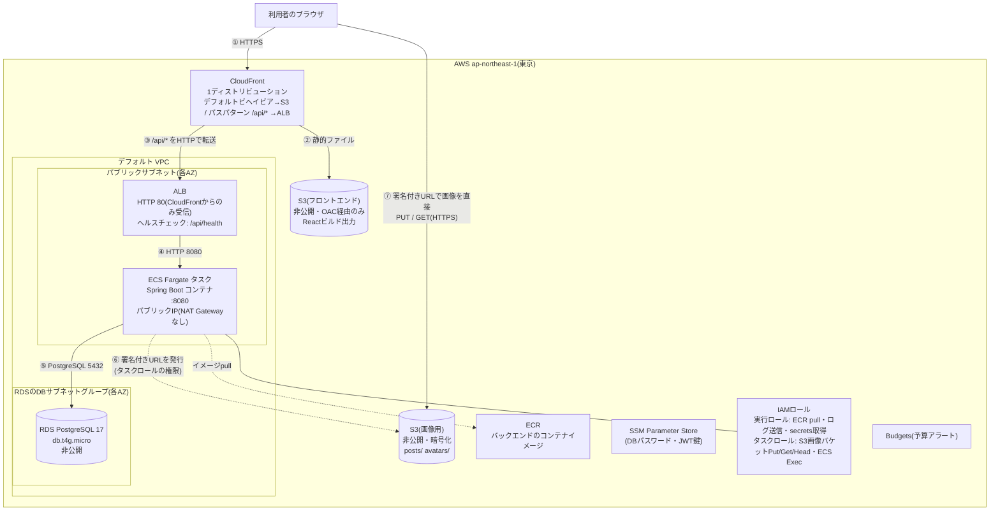
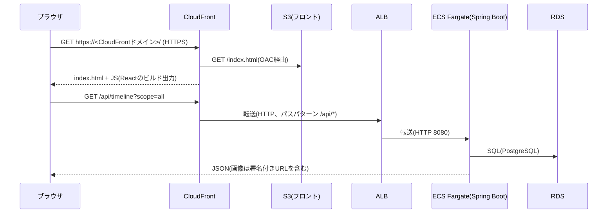

# 05. インフラ構成図(AWS)

要件定義書([01-requirements.md](01-requirements.md))6.2・10.3 の補足資料です。EC2 を使わず、フロントエンドは **S3 + CloudFront**、バックエンドは **ECS Fargate** で構築する構成です。構築コードは [infra/terraform/](../infra/terraform/) にあります。

TaskManagement の AWS 構成([../../TaskManagment/docs/aws-deploy-guide.md](../../TaskManagment/docs/aws-deploy-guide.md))をベースに、デフォルト VPC を使う方針は引き継ぎつつ、**EC2 を ECS Fargate に、jar 同梱のフロント配信を S3 + CloudFront に置き換えています**。

## 1. 全体構成図

| 番号 | 通信 | 内容 |
|---|---|---|
| ① | ブラウザ → CloudFront | ページ(React の静的ファイル)と `/api/*` の両方を1ドメインで受ける。TLS はここで終端(証明書は CloudFront 既定のもの。独自ドメインは未定) |
| ② | CloudFront → S3(フロント) | デフォルトビヘイビア。OAC(Origin Access Control)経由でのみ読める |
| ③ | CloudFront → ALB | パスパターン `/api/*`。AWS 内部は HTTP(ALB は CloudFront のプレフィックスリストからのみ受信) |
| ④ | ALB → ECS Fargate タスク | 8080 番へ転送。ターゲットグループのヘルスチェックは `GET /api/health`(200) |
| ⑤ | ECS Fargate タスク → RDS | 5432 番。DB はインターネットから届かない |
| ⑥ | ECS Fargate タスク → S3(画像) | アプリが署名付き URL を生成する(署名はローカル計算)。投稿作成時の存在確認(`HeadObject`)のみ実際に S3 へ通信 |
| ⑦ | ブラウザ → S3(画像) | **画像本体は ECS を経由しない**。ブラウザが署名付き URL で S3 へ直接アップロード/取得する |

## 2. リクエストの流れ
### 2.1 ページ表示・API

### 2.2 画像のアップロード
詳細なシーケンスは [features/F-POST.md](features/F-POST.md) の 4 章を参照。

## 3. ネットワークとセキュリティグループ

| セキュリティグループ | 受信(許可) | 送信 | 備考 |
|---|---|---|---|
| alb-sg | 80(HTTP)。接続元は **CloudFront の AWS 管理プレフィックスリスト(`com.amazonaws.global.cloudfront.origin-facing`)のみ** | fargate-sg の 8080 | 利用者は直接 ALB を叩けない |
| fargate-sg(ECS Fargate タスク) | **8080 は alb-sg からのみ** | 全て許可(RDS・S3・ECR・CloudWatch Logs) | 操作は ECS Exec(`aws ecs execute-command`) |
| db-sg(RDS) | **5432 は fargate-sg からのみ** | なし | パブリックアクセス無効 |

- **NAT Gateway は置かない**(常時課金のため)。ECS Fargate タスクはパブリックサブネットに置き、パブリック IP でインターネット(ECR・RDS 以外への通信・CloudWatch Logs)へ出る。ただし受信は fargate-sg で ALB に限定されるため、外部から直接は入れない。
- RDS は DB サブネットグループに **2 つの AZ のサブネット**を登録する(RDS の仕様上必須)。実体は片方の AZ に作る(Multi-AZ なし)。
- TaskManagement と同じく **デフォルト VPC** を使う(専用 VPC は作らない。サブネットは既存の複数 AZ のものを使う)。

## 4. S3(画像用バケット)

| 項目 | 設定 |
|---|---|
| パブリックアクセス | すべてブロック(ブロックパブリックアクセス ON)。バケットポリシーで公開しない |
| 暗号化 | SSE-S3(既定) |
| キーの構成 | `posts/{userId}/{uuid}.{ext}`(投稿画像)/ `avatars/{userId}/{uuid}.{ext}`(アイコン) |
| アクセス方法 | 署名付き URL のみ。PUT は有効期限 5 分、GET は短時間(例: 15 分) |
| CORS | 許可オリジン=CloudFrontのドメイン。メソッド=`PUT`・`GET`・`HEAD`。ヘッダー=`Content-Type`。`ExposeHeaders`=`ETag` |
| ライフサイクル | 拡張候補: 投稿に使われなかった未使用オブジェクトの自動削除 |
| フロントエンド用バケットとの関係 | **別バケット**にする(画像用は非公開・署名付きURL、フロント用はCloudFrontのOAC経由のみ) |

**ECS タスクロール**に付ける権限(最小限):
- 画像バケットの `s3:PutObject` / `s3:GetObject` / `s3:HeadObject` / `s3:DeleteObject`(削除は将来のバッチ用。必要になるまで付けなくてよい)
- ECS Exec用の `ssmmessages:*`(コンテナにシェルで入るため)

タスク実行ロール(アプリ自身は使わない、ECSエージェント用)には、ECRからのpullとCloudWatch Logsへの書き込み(`AmazonECSTaskExecutionRolePolicy`)、DBパスワード・JWT鍵のSSM Parameter Store読み取り権限を付ける。

署名付き URL は、署名したロールの権限で有効になる。ロールに付けた権限を超える操作はできない。

## 5. アプリの設定(環境変数)

ECSタスク定義のコンテナ定義で設定する(`infra/terraform/ecs.tf`)。

| 環境変数 | 値 | 理由 |
|---|---|---|
| `DB_HOST` / `DB_PORT` / `DB_NAME` / `DB_USER` | RDSのホスト名 / `5432` / Terraformの変数 | RDSへの接続先 |
| `DB_PASSWORD`(secrets) | SSM Parameter Store(SecureString)から取得 | 認証情報をコードに置かない |
| `JWT_SECRET`(secrets) | 32 バイト以上のランダム文字列。SSM Parameter Store(SecureString)から取得 | JWT の署名鍵。タスクが複数になっても全タスクで同じ値になる(SSMから同じ値を取得するため) |
| `REFRESH_COOKIE_SECURE` | 未設定(既定 `true`) | リフレッシュトークンの Cookie に Secure 属性を付ける。CloudFrontがHTTPSを終端するため既定のままでよい |
| `S3_BUCKET` / `AWS_REGION` | 画像用バケット名 / `ap-northeast-1` | 署名付き URL の発行先 |
| `S3_ENDPOINT` / `S3_ACCESS_KEY` / `S3_SECRET_KEY` | **AWS では設定しない(空)**。開発では docker-compose の S3 互換サーバー(`http://localhost:9000`)と、ダミーのキー | endpoint が空なら AWS S3 に接続し、キーが空ならタスクロールで認証する(アクセスキーを作らない) |
| `APP_ENV` / `LOG_FORMAT` | `prod` / `ecs` | ログをJSON形式で出力する(docs/07-observability.md) |

## 6. 運用・費用

- 操作は **ECS Exec**(`aws ecs execute-command`)で行う(SSH なし)。ログは CloudWatch Logs(`/ecs/raisetimeline-backend`)を確認する。
- **Budgets** で予算超過をメール通知する。
- 目安(東京リージョン・出しっぱなし)。数字は目安で、実際は [AWS 料金計算ツール](https://calculator.aws/)で確認する。

| 項目 | 目安(月) |
|---|---|
| ECS Fargate(0.25vCPU/0.5GB、常時起動) | 約 $9〜10 |
| RDS db.t4g.micro | 約 $19 |
| RDS ストレージ 20GB | 約 $3 |
| **ALB**(固定費+使用量) | **約 $18〜25** |
| パブリック IPv4(ALB・Fargateタスクが使う分) | 約 $3.6 × 使用数 |
| CloudFront(小規模な配信量) | 数百円〜数ドル |
| S3(数 GB) | 数十円〜 |
| 合計 | **約 $55〜65 前後** |

ALB は**常時課金**。使わない間はECSサービスの `desired_count` を 0 にするか、`terraform destroy` で全て消す運用にすると、課金は稼働時間分に抑えられる。

## 7. 未確定事項・注意点

| 項目 | 現状の想定 | 備考 |
|---|---|---|
| 独自ドメインと ACM 証明書 | 未定 | 現状は CloudFront 既定のドメイン(`*.cloudfront.net`)と既定証明書を使う。独自ドメインが決まったら、**us-east-1** の ACM 証明書を CloudFront に追加する。ALB(ap-northeast-1)へのオリジン接続もHTTPS化する場合は、別途 ap-northeast-1 の ACM 証明書が必要 |
| ECS Fargate タスク数 | 当面 1 台 | ALB は複数タスクへも振り分けられる |
| ログイン状態の持ち方 | アクセストークン JWT(サーバーに状態を持たない)+ リフレッシュトークン(DB で管理) | タスクを複数にしても、`JWT_SECRET` をSSMから共有し、DB(RDS)を共有すれば追加対策は不要(セッション共有やスティッキーセッションは不要) |
| RDS のバックアップ・Multi-AZ | なし(学習用) | 削除するとデータは消える。残したいデータが出たら有効化を検討 |
| CloudFront→画像配信への適用 | なし | 画像用S3への署名付きURLアクセスをCloudFront経由にする拡張候補(現状はS3へ直接アクセス) |
| WAF | なし | 公開範囲を広げる場合に検討 |
| CI/CDでのビルド・デプロイ | 実装済み | GitHub Actions(`.github/workflows/deploy.yml`)でOIDC連携により自動化。手順は [06-deploy.md](06-deploy.md) |

## 8. TaskManagement との構成の違い
| 項目 | TaskManagement | RaiseTimeLine(本構成) |
|---|---|---|
| 入口 | Elastic IP + Caddy(Let's Encrypt、`<IP>.sslip.io`) | **CloudFront**(既定ドメイン) |
| HTTPS 終端 | EC2 上の Caddy | CloudFront |
| 実行環境 | EC2 | **ECS Fargate** |
| フロントエンド配信 | jarに同梱してEC2から配信 | **S3 + CloudFront**(ビルド出力を独立配信) |
| サブネット | デフォルト VPC | デフォルト VPC(同方針) |
| S3 | jar の受け渡し用 | **フロントエンド用バケット**・**画像用バケット**(いずれも非公開) |
| 台数 | 1 台(セッションがメモリのため) | 当面 1 タスク(JWT のため、複数化は鍵の共有のみで可能) |
| デプロイ | 手動(PowerShellスクリプト) | **GitHub Actions(OIDC連携)で自動化**(06章) |
