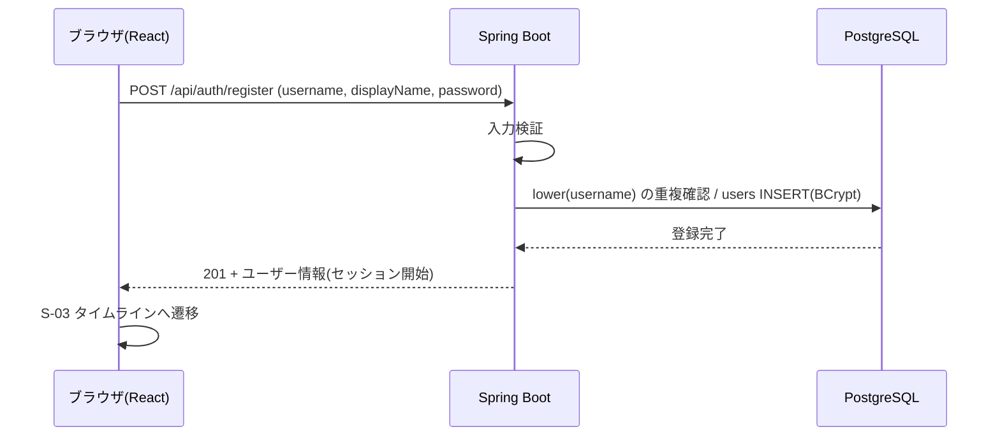

# F-AUTH 機能定義書: アカウント・ログイン

[← 機能一覧](../02-features.md) / [要件定義書](../01-requirements.md)

## 1. 概要
ユーザーID・パスワードでアカウントを登録し、ログイン・ログアウトする。認証は Spring Security のセッション方式(TaskManagement と同じ)。パスワードは BCrypt でハッシュ化して保存する。

| 項目 | 内容 |
|---|---|
| 対象機能 | F-AUTH-01 新規登録 / 02 ログイン / 03 ログアウト / 04 ログインユーザー取得 |
| 関連画面 | S-01 新規登録 / S-02 ログイン / 共通ヘッダー |
| 関連API | `POST /api/auth/register` / `POST /api/auth/login` / `POST /api/auth/logout` / `GET /api/auth/me` |
| 関連テーブル | users |
| 権限 | register・login は未ログイン可。logout・me はログイン必須 |

## 2. 入出力項目と検証
### 新規登録(`POST /api/auth/register`)
| 項目 | 必須 | 検証 |
|---|---|---|
| username | ○ | 3〜15文字、`^[A-Za-z0-9_]+$`。**大文字小文字を区別せず**重複不可(BR-11)。前後の空白は不可(エラーとする) |
| displayName | ○ | 前後の空白を除いて 1〜30文字 |
| password | ○ | 8〜72文字(BCrypt の上限 72 バイトに合わせる) |
| passwordConfirm | 画面のみ | password と一致(画面で確認。API には送らない) |

応答: 201 + ユーザー情報(`id`、`username`、`displayName`、`avatarUrl`)。パスワード(ハッシュ含む)は返さない。

### ログイン(`POST /api/auth/login`)
| 項目 | 必須 | 検証 |
|---|---|---|
| username | ○ | 空でない。照合は大文字小文字を区別しない |
| password | ○ | 空でない |

応答: 200 + ユーザー情報。セッション Cookie(HttpOnly)を発行。

## 3. 業務ルール
- ユーザーIDの一意性は DB の `UNIQUE INDEX (lower(username))` で保証する(同時登録の競合は 409 に変換)。
- 登録時の表記(例: `Hanako_01`)は保持して表示する。ログイン・検索は大文字小文字を区別しない。
- ログイン失敗時は、ユーザーIDの存在有無を区別できないメッセージを返す。
- ログイン成功時はセッション ID を再発行する(セッション固定化対策)。
- ID・パスワードを忘れた場合の復旧手段は用意しない。

## 4. 基本フロー

1. 画面で入力 → 「登録する」。
2. バックエンドが検証し、重複がなければ登録。そのままログイン状態にする。
3. S-03 を表示する(「フォロー中」タブは空表示の案内つき)。

ログインは、2 で照合のみを行い、一致すれば 200 とセッションを返す。ログアウトはセッションを破棄し 204 を返し、画面は S-02 へ。

## 5. 代替・異常フロー
| 条件 | 結果 |
|---|---|
| ユーザーIDの形式不正・文字数超過、表示名・パスワードの不備 | 400。項目ごとのエラーを表示 |
| ユーザーIDが既に使われている(大文字小文字違いを含む) | 409「このユーザーIDは既に使われています」 |
| パスワードと確認用が不一致 | 画面でエラー(送信しない) |
| ユーザーID・パスワードが誤り | 401「ユーザーIDまたはパスワードが正しくありません」 |
| 未ログインで保護 API を呼ぶ | 401。画面は S-02 へ |
| CSRF トークンなしの更新系リクエスト | 403 |

## 6. セキュリティ
- 更新系リクエストは `X-XSRF-TOKEN` ヘッダ必須(Cookie `XSRF-TOKEN` を読み取って付与)。
- 本番(AWS)では Cookie に `Secure` を付け、ALB の背後でも HTTPS と認識させる(`server.forward-headers-strategy=framework`)。
- ログイン試行回数の制限は今回対象外(拡張候補)。

## 7. 受入条件
- [ ] 登録後、そのままログイン状態でタイムラインが表示される
- [ ] `Alice` を登録済みのとき、`alice` で登録しようとすると 409 になる
- [ ] `alice` で登録した後、`ALICE` でログインできる
- [ ] 誤ったパスワードでも存在しないIDでも、同じエラーメッセージになる
- [ ] ログアウト後、保護された API が 401 になる
- [ ] DB の `password_hash` が BCrypt 形式で、平文は保存されていない
