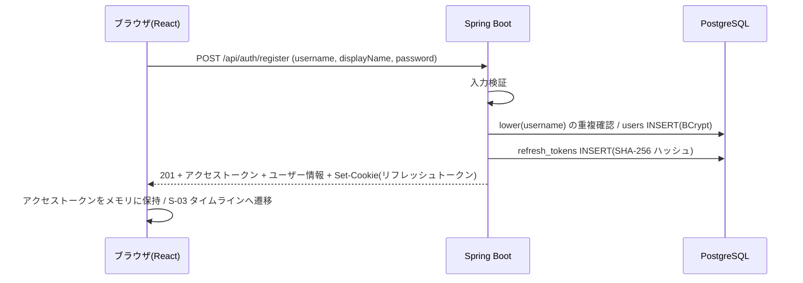
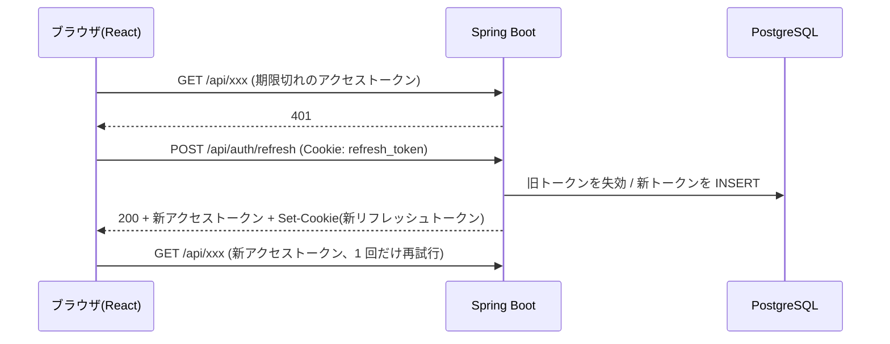

# F-AUTH 機能定義書: アカウント・ログイン

[← 機能一覧](../02-features.md) / [要件定義書](../01-requirements.md)

## 1. 概要
ユーザーID・パスワードでアカウントを登録し、ログイン・ログアウトする。認証は **アクセストークン(JWT, `Authorization: Bearer` ヘッダ)+ リフレッシュトークン(HttpOnly Cookie)** の方式で、アクセストークンは Spring Security の OAuth2 Resource Server で検証する(API の認可はステートレス)。リフレッシュトークンは DB で管理し、使用のたびに再発行(ローテーション)する。パスワードは BCrypt でハッシュ化して保存する。

| 項目 | 内容 |
|---|---|
| 対象機能 | F-AUTH-01 新規登録 / 02 ログイン / 03 ログアウト / 04 ログインユーザー取得 / 05 トークン更新 |
| 関連画面 | S-01 新規登録 / S-02 ログイン / 共通ヘッダー |
| 関連API | `POST /api/auth/register` / `login` / `refresh` / `logout` / `GET /api/auth/me` |
| 関連テーブル | users / refresh_tokens |
| 権限 | register・login・refresh・logout は未ログインでも呼べる(refresh・logout はリフレッシュトークンの Cookie を使う)。me はログイン必須 |

## 2. 入出力項目と検証
### 新規登録(`POST /api/auth/register`)
| 項目 | 必須 | 検証 |
|---|---|---|
| username | ○ | 3〜15文字、`^[A-Za-z0-9_]+$`。**大文字小文字を区別せず**重複不可(BR-11)。前後の空白は不可(エラーとする) |
| displayName | ○ | 前後の空白を除いて 1〜30文字 |
| password | ○ | 8〜72文字、かつ UTF-8 で 72 バイト以内(BCrypt は 72 バイトを超える部分を無視するため。日本語など複数バイト文字は 24 文字程度が上限) |
| passwordConfirm | 画面のみ | password と一致(画面で確認。API には送らない) |

応答: 201 + 認証情報(下記)+ `Set-Cookie`(リフレッシュトークン)。パスワード(ハッシュ含む)は返さない。登録後はそのままログイン状態になる。

```json
{
  "accessToken": "eyJ...",
  "tokenType": "Bearer",
  "expiresIn": 900,
  "user": { "id": 1, "username": "alice", "displayName": "アリス", "avatarUrl": null }
}
```
`expiresIn` はアクセストークンの有効期間(秒)。`avatarUrl` は画像機能(S3)の実装までは常に `null`。リフレッシュトークンはボディに含めず、Cookie でのみ返す。

### ログイン(`POST /api/auth/login`)
| 項目 | 必須 | 検証 |
|---|---|---|
| username | ○ | 空でない。照合は大文字小文字を区別しない |
| password | ○ | 空でない |

応答: 200 + 認証情報(登録時と同じ形式)+ `Set-Cookie`。

### トークン更新(`POST /api/auth/refresh`)
リクエストボディなし。リフレッシュトークンの Cookie を使う。応答: 200 + 認証情報(登録時と同じ形式。新しいアクセストークンとユーザー情報)+ 新しいリフレッシュトークンの `Set-Cookie`(古いものは失効する)。Cookie がない・無効・期限切れ・失効済みの場合は 401(Cookie も削除する)。

### ログアウト(`POST /api/auth/logout`)
リクエストボディなし。Cookie のリフレッシュトークンを失効させ、Cookie を削除して 204。**Cookie やアクセストークンがなくても 204**(冪等)。アクセストークンが期限切れでもログアウトできるよう、認証は不要とする。

### ログインユーザー取得(`GET /api/auth/me`)
`Authorization: Bearer <accessToken>` が必須。200 + ユーザー情報(`id`、`username`、`displayName`、`avatarUrl`)。

### リフレッシュトークンの Cookie
| 属性 | 値 | 理由 |
|---|---|---|
| 名前 | `refresh_token` | |
| HttpOnly | あり | JavaScript から読めなくする(XSS で盗まれにくい) |
| SameSite | Strict | 他サイトからのリクエストに付かない(CSRF 対策) |
| Path | `/api/auth` | 認証 API にしか送らない |
| Secure | 既定あり(`REFRESH_COOKIE_SECURE`) | HTTPS 前提。HTTP での検証時のみ無効にする |
| Max-Age | 7 日 | |

## 3. 業務ルール
- ユーザーIDの一意性は DB の `UNIQUE INDEX (lower(username))` で保証する(同時登録の競合は 409 に変換)。
- 登録時の表記(例: `Hanako_01`)は保持して表示する。ログイン・検索は大文字小文字を区別しない。
- ログイン失敗時は、ユーザーIDの存在有無を区別できないメッセージを返す。
- **アクセストークン**は HS256 で署名した JWT。`sub` にユーザーの `id`、`iat`・`exp` を持つ。有効期間は **15 分**(`app.jwt.expiration` で変更可)。
- **リフレッシュトークン**は 256 ビットの乱数(Base64URL)。有効期間は **7 日**(`app.refresh.expiration`)。DB(`refresh_tokens`)には SHA-256 ハッシュだけを保存し、平文は保存しない。
- **ローテーション**: リフレッシュのたびに新しいリフレッシュトークンを発行し、使ったものは失効する。
- **盗難検知**: 失効済みのリフレッシュトークンが再提示された場合、そのユーザーの全リフレッシュトークンを失効させる(全端末がログアウトされる)。ただし失効から **10 秒以内**(`app.refresh.reuse-grace`)の再提示は、複数タブの同時リフレッシュとみなして 401 を返すだけにし、全失効はしない。
- 期限切れのリフレッシュトークンは、そのユーザーのリフレッシュ時に DB から削除する。
- 署名鍵は環境変数 `JWT_SECRET`(32 バイト以上)で渡す。ソースや設定ファイルには書かない。
- トークンの検証後、`me` はユーザーが DB に存在することも確認する(存在しなければ 401)。
- ID・パスワードを忘れた場合の復旧手段は用意しない。

## 4. 基本フロー

1. 画面で入力 → 「登録する」。
2. バックエンドが検証し、重複がなければ登録。そのままログイン状態にする。
3. S-03 を表示する(「フォロー中」タブは空表示の案内つき)。

ログインは、2 で照合のみを行い、一致すれば 200 とアクセストークン・リフレッシュトークンを返す。

### トークンの更新と復元

- アクセストークンはメモリにだけ持つため、ページを開いたとき(リロード含む)は、画面がまず `POST /api/auth/refresh` を呼んでログイン状態を復元する。成功すれば S-03 などを表示し、401 なら S-02 へ遷移する。
- 同時に複数のリクエストが 401 になっても、画面側で `refresh` は 1 回にまとめる(ローテーションにより、同じトークンの二重使用が起きないようにする)。
- ログアウトは、`POST /api/auth/logout` でリフレッシュトークンを失効して Cookie を削除し、画面側もアクセストークンを破棄して S-02 へ遷移する。

## 5. 代替・異常フロー
| 条件 | 結果 |
|---|---|
| ユーザーIDの形式不正・文字数超過、表示名・パスワードの不備 | 400。項目ごとのエラーを表示 |
| ユーザーIDが既に使われている(大文字小文字違いを含む) | 409「このユーザーIDは既に使われています」 |
| パスワードと確認用が不一致 | 画面でエラー(送信しない) |
| ユーザーID・パスワードが誤り | 401「ユーザーIDまたはパスワードが正しくありません」 |
| トークンなし・署名不正・期限切れ・存在しないユーザーのトークンで保護 API を呼ぶ | 401。画面はトークン更新を 1 回試し、失敗したら S-02 へ |
| リフレッシュトークンが無い・無効・期限切れ・失効済み | 401「ログインが必要です」+ Cookie 削除。画面は S-02 へ |
| 失効済みのリフレッシュトークンの再提示(猶予 10 秒超) | 401。そのユーザーの全リフレッシュトークンを失効 |

## 6. セキュリティ
- アクセストークンは `Authorization: Bearer` ヘッダで送り、**ブラウザのメモリにのみ保持する**(localStorage・sessionStorage には置かない)。XSS が起きても、長期間有効なトークンは JavaScript から読めない。
- リフレッシュトークンは HttpOnly・SameSite=Strict・Path=`/api/auth` の Cookie。Cookie を認証に使うのは `refresh` と `logout` だけで、SameSite=Strict により他サイトからは送られず、応答のアクセストークンも他サイトのページからは読めないため、CSRF は無効にしている(追加対策として Origin ヘッダの検証は拡張候補)。
- ログアウトでリフレッシュトークンを失効するため、ログアウト後は新しいアクセストークンを取得できない。ただし発行済みのアクセストークンは期限(15 分)まで有効(ブラックリストなし)。トークン漏えい時は `JWT_SECRET` の更新(全アクセストークン失効)と、該当ユーザーの `refresh_tokens` の失効で対処する。
- 本番(AWS)は HTTPS 前提(ALB で終端)。
- ログイン試行回数の制限は今回対象外(拡張候補)。

## 7. 受入条件
- [ ] 登録後、そのままログイン状態でタイムラインが表示される
- [ ] `Alice` を登録済みのとき、`alice` で登録しようとすると 409 になる
- [ ] `alice` で登録した後、`ALICE` でログインできる
- [ ] 誤ったパスワードでも存在しないIDでも、同じエラーメッセージになる
- [ ] トークンなし・署名不正・期限切れのトークンでは、保護された API が 401 になる
- [ ] 72 バイトを超えるパスワード(例: 日本語 25 文字)は 400 になる
- [ ] DB の `password_hash` が BCrypt 形式で、平文は保存されていない
- [ ] ログイン・登録で、HttpOnly・SameSite=Strict・Path=`/api/auth` のリフレッシュトークン Cookie が発行される
- [ ] DB の `refresh_tokens` にはハッシュだけが保存され、平文は保存されていない
- [ ] リフレッシュすると新しいトークンが発行され、古いリフレッシュトークンは使えない
- [ ] 猶予を過ぎて使用済みのリフレッシュトークンを再提示すると、そのユーザーの全リフレッシュトークンが失効する
- [ ] ログアウト後は、そのリフレッシュトークンで更新できない
- [ ] 画面をリロードしてもログイン状態が維持される(メモリのトークンを `refresh` で復元する)
