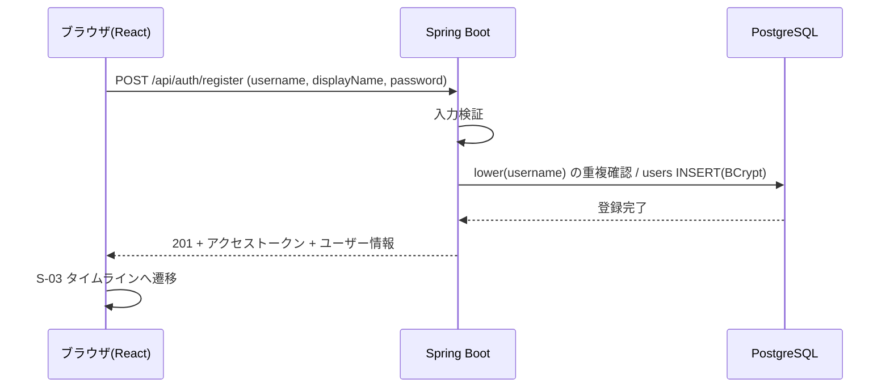

# F-AUTH 機能定義書: アカウント・ログイン

[← 機能一覧](../02-features.md) / [要件定義書](../01-requirements.md)

## 1. 概要
ユーザーID・パスワードでアカウントを登録し、ログイン・ログアウトする。認証は JWT(`Authorization: Bearer` ヘッダ)によるステートレス方式で、Spring Security の OAuth2 Resource Server で検証する。パスワードは BCrypt でハッシュ化して保存する。

| 項目 | 内容 |
|---|---|
| 対象機能 | F-AUTH-01 新規登録 / 02 ログイン / 03 ログアウト / 04 ログインユーザー取得 |
| 関連画面 | S-01 新規登録 / S-02 ログイン / 共通ヘッダー |
| 関連API | `POST /api/auth/register` / `POST /api/auth/login` / `POST /api/auth/logout` / `GET /api/auth/me` |
| 関連テーブル | users |
| 権限 | register・login は未ログイン可。logout・me はログイン必須 |

## 2. 入出力項目と検証
### 新規登録(`POST /api/auth/register`)
| 項目 | 必須 | 検証 |
|---|---|---|
| username | ○ | 3〜15文字、`^[A-Za-z0-9_]+$`。**大文字小文字を区別せず**重複不可(BR-11)。前後の空白は不可(エラーとする) |
| displayName | ○ | 前後の空白を除いて 1〜30文字 |
| password | ○ | 8〜72文字、かつ UTF-8 で 72 バイト以内(BCrypt は 72 バイトを超える部分を無視するため。日本語など複数バイト文字は 24 文字程度が上限) |
| passwordConfirm | 画面のみ | password と一致(画面で確認。API には送らない) |

応答: 201 + 認証情報(下記)。パスワード(ハッシュ含む)は返さない。登録後はそのままログイン状態になる。

```json
{
  "accessToken": "eyJ...",
  "tokenType": "Bearer",
  "expiresIn": 86400,
  "user": { "id": 1, "username": "alice", "displayName": "アリス", "avatarUrl": null }
}
```
`expiresIn` は有効期間(秒)。`avatarUrl` は画像機能(S3)の実装までは常に `null`。

### ログイン(`POST /api/auth/login`)
| 項目 | 必須 | 検証 |
|---|---|---|
| username | ○ | 空でない。照合は大文字小文字を区別しない |
| password | ○ | 空でない |

応答: 200 + 認証情報(登録時と同じ形式)。

### ログアウト(`POST /api/auth/logout`) / ログインユーザー取得(`GET /api/auth/me`)
どちらも `Authorization: Bearer <accessToken>` が必須。logout は 204、me は 200 + ユーザー情報(`id`、`username`、`displayName`、`avatarUrl`)。

## 3. 業務ルール
- ユーザーIDの一意性は DB の `UNIQUE INDEX (lower(username))` で保証する(同時登録の競合は 409 に変換)。
- 登録時の表記(例: `Hanako_01`)は保持して表示する。ログイン・検索は大文字小文字を区別しない。
- ログイン失敗時は、ユーザーIDの存在有無を区別できないメッセージを返す。
- アクセストークンは HS256 で署名した JWT。`sub` にユーザーの `id`、`iat`・`exp` を持つ。有効期間は 24 時間(`app.jwt.expiration` で変更可)。リフレッシュトークンは使わず、期限が切れたら再ログインする。
- 署名鍵は環境変数 `JWT_SECRET`(32 バイト以上)で渡す。ソースや設定ファイルには書かない。
- トークンの検証後、`me` はユーザーが DB に存在することも確認する(存在しなければ 401)。
- ID・パスワードを忘れた場合の復旧手段は用意しない。

## 4. 基本フロー

1. 画面で入力 → 「登録する」。
2. バックエンドが検証し、重複がなければ登録。そのままログイン状態にする。
3. S-03 を表示する(「フォロー中」タブは空表示の案内つき)。

ログインは、2 で照合のみを行い、一致すれば 200 とアクセストークンを返す。ログアウトは 204 を返し、画面側がトークンを破棄して S-02 へ遷移する。

## 5. 代替・異常フロー
| 条件 | 結果 |
|---|---|
| ユーザーIDの形式不正・文字数超過、表示名・パスワードの不備 | 400。項目ごとのエラーを表示 |
| ユーザーIDが既に使われている(大文字小文字違いを含む) | 409「このユーザーIDは既に使われています」 |
| パスワードと確認用が不一致 | 画面でエラー(送信しない) |
| ユーザーID・パスワードが誤り | 401「ユーザーIDまたはパスワードが正しくありません」 |
| トークンなし・署名不正・期限切れ・存在しないユーザーのトークンで保護 API を呼ぶ | 401。画面は S-02 へ |

## 6. セキュリティ
- トークンは `Authorization: Bearer` ヘッダで送る。Cookie を使わないため CSRF 対策は不要(CSRF は無効)。
- **ログアウトのサーバー側失効は行わない**(ブラックリストなし)。ログアウト後も、発行済みトークンは期限(既定 24 時間)まで有効。クライアントがトークンを破棄する前提とし、トークン漏えい時は `JWT_SECRET` の更新(全トークン失効)で対処する。即時失効が必要になった場合は、拡張候補としてトークン ID の失効リストを導入する。
- フロントエンドでのトークン保管先は画面実装時に決める(`localStorage` は XSS で読み取られるため、XSS 対策(出力のエスケープ)と合わせて検討)。
- 本番(AWS)は HTTPS 前提(ALB で終端)。
- ログイン試行回数の制限は今回対象外(拡張候補)。

## 7. 受入条件
- [ ] 登録後、そのままログイン状態でタイムラインが表示される
- [ ] `Alice` を登録済みのとき、`alice` で登録しようとすると 409 になる
- [ ] `alice` で登録した後、`ALICE` でログインできる
- [ ] 誤ったパスワードでも存在しないIDでも、同じエラーメッセージになる
- [ ] トークンなし・署名不正・期限切れのトークンでは、保護された API が 401 になる
- [ ] 72 バイトを超えるパスワード(例: 日本語 25 文字)は 400 になる
- [ ] DB の `password_hash` が BCrypt 形式で、平文は保存されていない
