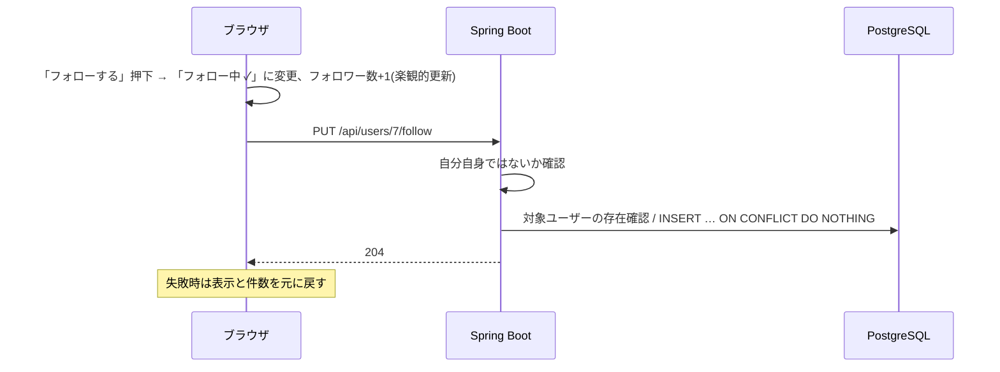

# F-FOLLOW 機能定義書: フォロー・フォロワー

[← 機能一覧](../02-features.md) / [要件定義書](../01-requirements.md)

## 1. 概要
他のユーザーをフォローし、フォロー中の人の投稿を「フォロー中」タイムラインで見られるようにする。**承認は不要**(誰でも自由にフォロー/解除できる)。プロフィールにはフォロー数・フォロワー数を表示し、一覧画面で確認できる。

| 項目 | 内容 |
|---|---|
| 対象機能 | F-FOLLOW-01 フォロー / 02 解除 / 03 フォロー中一覧 / 04 フォロワー一覧 / 05 件数表示 / 06 フォローボタン共通部品 |
| 関連画面 | S-05 プロフィール / S-07 ユーザー検索 / S-08 フォロー中・フォロワー一覧 |
| 関連API | `PUT/DELETE /api/users/{id}/follow` / `GET /api/users/{id}/following` / `GET /api/users/{id}/followers` |
| 関連テーブル | follows |
| 権限 | ログイン必須 |

## 2. 入出力項目
### フォロー・解除
`PUT /api/users/{id}/follow`(フォロー)/ `DELETE /api/users/{id}/follow`(解除)。本文なし、応答 204。`{id}` はフォロー対象のユーザーID(内部ID)。フォローする側は常にログイン中のユーザー。

### 一覧(`GET /api/users/{id}/following` / `…/followers`)
| パラメータ | 内容 |
|---|---|
| cursor / limit | `follows.created_at` 降順(新しくフォローした順)。limit 既定 20、最大 50 |

応答の項目:
```json
{
  "items": [
    { "id": 7, "username": "hanako", "displayName": "佐藤花子", "avatarUrl": "https://…", "bio": "…", "followedByMe": true }
  ],
  "nextCursor": null
}
```
`followedByMe` は「ログイン中のユーザーがこの人をフォロー済みか」。自分自身の行では `null`(ボタン非表示)。

### 件数
`GET /api/users/{id}`(プロフィール)に `followingCount`、`followerCount`、`followedByMe` を含める(F-PROF)。

## 3. 業務ルール
- 自分自身はフォローできない(BR-12)。API は 400、DB は `CHECK (follower_id <> followee_id)`。
- **冪等**: すでにフォロー済みの `PUT` は何もせず 204。フォローしていない相手への `DELETE` も 204。
- 対象ユーザーが存在しなければ 404。
- フォローされた側への通知や承認はない。
- 「フォロー中」タイムラインは、フォローした直後から相手の過去の投稿を含めて表示する(BR-13、F-TL)。
- 件数は `follows` から集計する。

## 4. 基本フロー

解除は「フォロー中 ✓」押下 → `DELETE`。誤操作を防ぐため、解除の確認ダイアログは**出さない**(再フォローが容易なため)。

### 起点となる画面
| 起点 | 操作 |
|---|---|
| S-03 / S-04 の投稿者名・コメント者名 | クリック → S-05 → フォローボタン(F-SEARCH-03) |
| S-07 検索結果 | 行のボタンで直接フォロー/解除。行クリックで S-05 |
| S-08 一覧 | 各行のボタンで直接フォロー/解除 |

フォローボタンは共通部品(F-FOLLOW-06)とし、どの画面でも同じ見た目・同じ API 呼び出しにする。

## 5. 代替・異常フロー
| 条件 | 結果 |
|---|---|
| 自分自身をフォロー | 400 |
| 存在しないユーザー | 404 |
| 未ログイン | 401 |
| 通信失敗 | 楽観的更新を元に戻し、エラー表示 |
| 一覧が 0 件 | 「まだいません」 |
| ボタン連打 | リクエスト中は無効化。重複しても冪等のため 1 件のまま |

## 6. 受入条件
- [ ] 他人のプロフィールで「フォローする」を押すと「フォロー中 ✓」になり、相手のフォロワー数が +1 になる
- [ ] フォロー後、「フォロー中」タイムラインに相手の投稿が出る。解除すると出なくなる
- [ ] 自分のプロフィールにはフォローボタンが表示されない。API で自分をフォローすると 400
- [ ] フォロー中/フォロワー一覧が新しい順に 20 件ずつ表示され、各行で操作できる
- [ ] `PUT` を 2 回送ってもエラーにならず、`follows` は 1 行のまま
- [ ] 検索結果・プロフィール・一覧で、フォロー状態の表示が一致している
