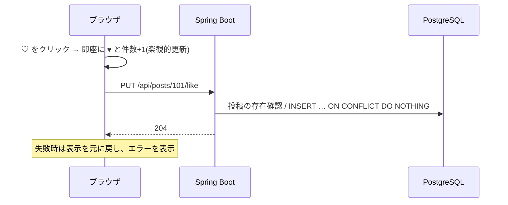

# F-LIKE 機能定義書: いいね

[← 機能一覧](../02-features.md) / [要件定義書](../01-requirements.md)

## 1. 概要
投稿に「いいね」を付け、取り消せる。第三者のいいねも含めた**いいね数**を全ユーザーに表示し、自分がいいね済みかも示す。

| 項目 | 内容 |
|---|---|
| 対象機能 | F-LIKE-01 いいね / 02 取り消し / 03 いいね数表示 |
| 関連画面 | S-03 / S-04 / S-05(投稿カード) |
| 関連API | `PUT /api/posts/{id}/like` / `DELETE /api/posts/{id}/like` |
| 関連テーブル | likes |
| 権限 | ログイン必須 |

## 2. 入出力項目
いずれもリクエスト本文なし。応答は 204(本文なし)。最新の件数は、画面側で楽観的に更新するか、`GET /api/posts/{id}` で再取得する。

## 3. 業務ルール
- 1ユーザー1投稿1回(BR-04)。`likes` の主キー `(user_id, post_id)` で保証。
- **冪等**: すでにいいね済みの `PUT` は何もせず 204(`INSERT … ON CONFLICT DO NOTHING`)。いいねしていない `DELETE` も 204。
- 自分の投稿にもいいねできる(BR-07)。
- 対象の投稿が存在しない/削除済みなら 404。
- いいねした人の一覧は表示しない(件数のみ)。

## 4. 基本フロー(画面)

取り消しは同様に `DELETE`。連打対策として、リクエスト中はそのボタンを無効化する。

## 5. 代替・異常フロー
| 条件 | 結果 |
|---|---|
| 未ログイン | 401 |
| 対象投稿が存在しない/削除済み | 404 |
| 通信失敗 | 楽観的更新を元に戻す。「しばらくしてから再度お試しください」 |
| 同じ投稿へ同時に複数端末から | 主キー制約により 1 件のみ登録 |

## 6. 受入条件
- [ ] いいねすると件数が +1 になり、自分のボタンが強調される
- [ ] 別のユーザーが同じ投稿にいいねすると、双方に件数が反映される(再取得後)
- [ ] 連続で `PUT` を 2 回送っても件数は +1 のまま(エラーにならない)
- [ ] 取り消すと件数が −1 になる
- [ ] 削除済みの投稿へのいいねは 404
