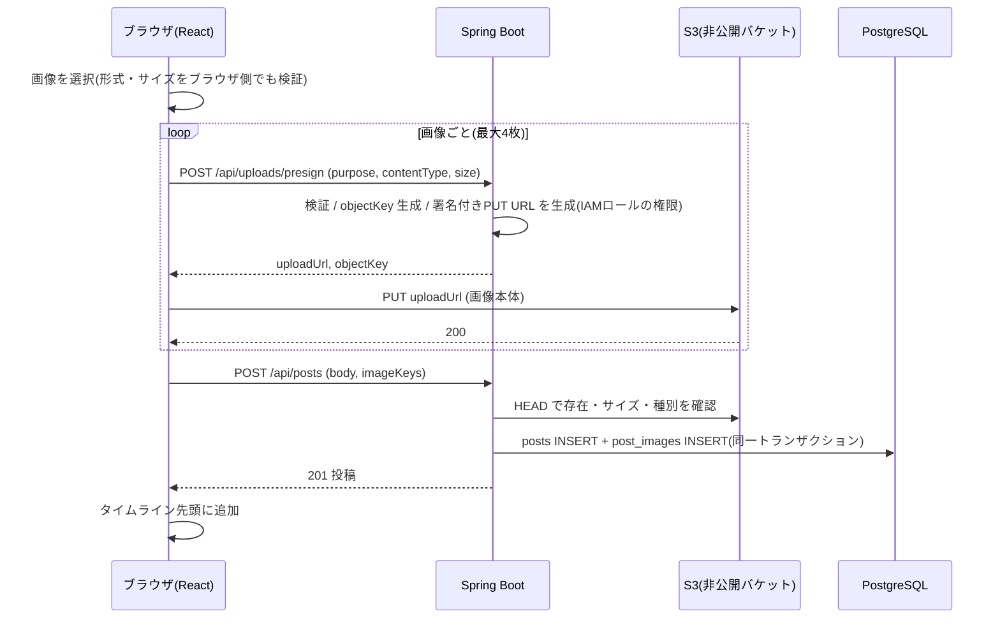

# F-POST 機能定義書: 投稿(画像を含む)

[← 機能一覧](../02-features.md) / [要件定義書](../01-requirements.md)

## 1. 概要
テキスト(最大280字)と画像(最大4枚)を投稿する。画像は **AWS S3** に保存し、ブラウザが**署名付きURLで S3 へ直接アップロード**する。自分の投稿は編集(本文のみ)・削除できる。リポスト・引用は提供しない。

| 項目 | 内容 |
|---|---|
| 対象機能 | F-POST-01 作成 / 02 画像添付 / 03 画像プレビュー / 04 画像表示 / 05 削除 / 06 編集 |
| 関連画面 | S-03 投稿フォーム・カード / S-04 / S-05 |
| 関連API | `POST /api/uploads/presign` / `POST /api/posts` / `PATCH /api/posts/{id}` / `DELETE /api/posts/{id}` |
| 関連テーブル | posts, post_images |
| 権限 | 作成: ログイン / 編集・削除: 作成者のみ |

## 2. 入出力項目と検証
### 署名付きURL発行(`POST /api/uploads/presign`)
| 項目 | 必須 | 検証 |
|---|---|---|
| purpose | ○ | `POST`(投稿画像)または `AVATAR`(F-PROF) |
| contentType | ○ | `image/jpeg` / `image/png` / `image/gif` / `image/webp` のいずれか |
| size | ○ | バイト数。`POST` は 5MB 以下、`AVATAR` は 2MB 以下(BR-02, BR-09) |

応答: `{ "uploadUrl": "署名付きPUT URL", "objectKey": "posts/7/3f2a….jpg", "expiresIn": 300, "requiredHeaders": { "Content-Type": "image/jpeg" } }`。`objectKey` は サーバーが `purpose/{userId}/{uuid}.{拡張子}` で生成する(クライアントはキーを決められない)。署名付きURLの有効期限は 5 分。

### 投稿作成(`POST /api/posts`)
| 項目 | 必須 | 検証 |
|---|---|---|
| body | ○ | 前後の空白を除いて 1〜280文字(BR-01) |
| imageKeys | - | 0〜4件の `objectKey`。各キーは **自分が発行した `posts/{自分のID}/` 配下**であること。S3 上に存在し、サイズ・種別が条件内であること |

応答: 201 + 投稿(F-TL の項目と同じ。`likeCount`=0、`commentCount`=0)。

### 投稿編集(`PATCH /api/posts/{id}`)
| 項目 | 必須 | 検証 |
|---|---|---|
| body | ○ | 前後の空白を除いて 1〜280文字(BR-01)。画像は変更できない |

応答: 200 + 更新後の投稿。`updatedAt` が更新され、`createdAt` より後になる(画面は「編集済み」を表示)。

## 3. 業務ルール
- 画像のみの投稿は不可(BR-01)。画像は最大4枚、順序は `sort_order` 0〜3(BR-02)。
- 削除は論理削除(`deleted_at`)。コメント・いいね・画像は参照側で非表示になる(BR-06)。S3 のオブジェクトは今回は削除しない。
- 本人以外の編集・削除は 403。存在しない/削除済みは 404。
- 編集は本文のみ(BR-05)。編集履歴は残さない。
- 実装は段階的に進める。実装済み: テキストの投稿・編集・削除、`POST /api/uploads/presign`(署名付き URL の発行。開発では docker-compose の S3 互換サーバー)。投稿への画像添付(`imageKeys`・`post_images`・プレビュー・カードの画像表示)は後続。

## 4. 基本フロー(画像つき投稿)

画像本体は EC2 を経由しない(S3 へ直接送る)。S3 バケットには、アプリのオリジン(ALB のドメイン)からの PUT/GET を許可する CORS 設定が必要([05-infrastructure.md](../05-infrastructure.md))。

## 5. 画面仕様
- 投稿フォーム(S-03): 「投稿する」ボタンで開くモーダル。本文の残り文字数を表示。画像は選択直後にプレビューし、個別に取り消せる(F-POST-03)。投稿中はボタンを無効化し二重送信を防ぐ。
- 画像表示(F-POST-04): 1枚=大きく、2枚=横2分割、3〜4枚=グリッド。クリックで拡大表示は拡張候補。
- 編集: 自分の投稿にのみ「編集」を表示。押すと投稿フォームと同じモーダルが元の本文つきで開き(残り文字数つき)、「保存」「キャンセル」で確定・破棄する。入力が残ったまま閉じようとすると破棄の確認をする。編集済みは日時の横に「(編集済み)」を表示。
- 削除: 自分の投稿にのみ「削除」を表示。確認ダイアログ(「削除する」/「キャンセル」)の後に削除。

## 6. 代替・異常フロー
| 条件 | 結果 |
|---|---|
| 本文が空・281文字以上 | 400 |
| 画像が5枚以上、形式・サイズ不正 | ブラウザ側で選択時に拒否。API でも 400 |
| 他人のキー・存在しないキーを `imageKeys` に指定 | 400 |
| S3 へのアップロードに失敗(通信断・期限切れ) | 画像ごとにエラー表示し再試行できる。投稿は作成されない |
| アップロード後に投稿を作らず離脱 | S3 に未使用オブジェクトが残る(今回は許容。ライフサイクルルールでの削除は拡張候補) |
| 他人の投稿を編集・削除 | 403 |
| 削除済み・存在しない投稿を編集・削除 | 404 |

## 7. 受入条件
- [ ] 本文のみ・本文+画像1〜4枚の投稿ができる
- [ ] 5枚目の追加、6MBの画像、PDF ファイルは拒否される
- [ ] 画像が S3 に保存され、DB にはオブジェクトキーだけが保存されている(URL は保存されない)
- [ ] バケットを直接 URL で開いても閲覧できない(署名付きURLのみ有効)
- [ ] 自分の投稿だけ編集でき、編集後は本文が更新され「編集済み」と表示される
- [ ] 他人の投稿の編集・削除が 403 になる
- [ ] 自分の投稿だけ削除でき、削除後は一覧・詳細から消える
- [ ] 他人のキーを `imageKeys` に入れた投稿作成が 400 になる
