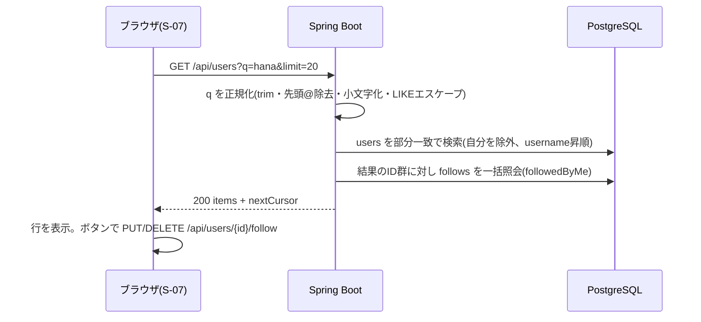

# F-SEARCH 機能定義書: ユーザー検索

[← 機能一覧](../02-features.md) / [要件定義書](../01-requirements.md)

## 1. 概要
ユーザーを**ユーザーID・表示名**で検索し、結果からプロフィールを開いたり、そのままフォローしたりできる。加えて、投稿・コメントに表示されたユーザー名をクリックしてプロフィールへ移動し、フォローすることもできる。検索対象は**ユーザーのみ**で、投稿本文やコメントは検索しない。

| 項目 | 内容 |
|---|---|
| 対象機能 | F-SEARCH-01 ユーザー検索 / 02 検索結果表示 / 03 プロフィールへの遷移 |
| 関連画面 | S-07 ユーザー検索 / S-03・S-04(ユーザー名リンク)/ S-05 |
| 関連API | `GET /api/users` |
| 関連テーブル | users, follows |
| 権限 | ログイン必須 |

## 2. 入出力項目と検証
### 検索(`GET /api/users`)
| パラメータ | 必須 | 検証・内容 |
|---|---|---|
| q | ○ | 前後の空白を除いて 1〜50文字。先頭の `@` は取り除く。空は 400 |
| cursor | - | 前回応答の `nextCursor` |
| limit | - | 1〜50、既定 20 |

応答: F-FOLLOW の一覧と同じ形式(`id`、`username`、`displayName`、`avatarUrl`、`bio`、`followedByMe`)+ `nextCursor`。

## 3. 業務ルール
- **一致条件**: `lower(username) LIKE :p OR lower(display_name) LIKE :p`(`:p` = `%` + 小文字化したキーワード + `%`)。大文字小文字を区別しない部分一致(BR-15)。
- **エスケープ**: キーワード中の `%` `_` `\` は文字として扱うようエスケープし、`ESCAPE '\'` を指定する(入力で全件一致させない)。SQL はプレースホルダ(パラメータ化)で組み立てる。
- **除外**: ログイン中の自分自身は結果に含めない。
- **並び順**: ユーザーID(`lower(username)`)昇順、同一なら `id` 昇順。カーソルは `(lower(username), id)`。
- **性能**: `pg_trgm` の GIN インデックス([04-er-diagram.md](../04-er-diagram.md))で部分一致を高速化する。1文字の検索は件数が多くなるため、上限 `limit` で制限する。
- 検索履歴・おすすめユーザーは今回扱わない。

## 4. 基本フロー

### プロフィールを経由するフォロー(F-SEARCH-03)
1. S-03 / S-04 の投稿者名・コメント者名、または S-07 の行をクリック。
2. S-05 を表示(`GET /api/users/{id}`)。
3. 「フォローする」を押す(F-FOLLOW-01)。

## 5. 画面仕様(S-07)
- ヘッダーの検索ボックス → S-07 へ。S-07 の検索欄は Enter で実行。
- 入力が空のときは API を呼ばず、案内文を表示。
- 0 件: 「該当するユーザーが見つかりません」。
- 件数が多いときは「もっと見る」で続きを取得。

## 6. 代替・異常フロー
| 条件 | 結果 |
|---|---|
| q が空、または 51文字以上 | 400(画面では送信前に検証) |
| 未ログイン | 401 |
| 該当なし | 200 で `items` が空 |
| `%` や `_` だけを入力 | 文字として検索(全件一致にはならない) |
| 通信失敗 | エラー表示。入力値は保持 |

## 7. 受入条件
- [ ] `hana` で `hanako` `Hanayama`(大文字含む)が見つかる。表示名「花子」でも見つかる
- [ ] `@hana` と入力しても `hana` と同じ結果になる
- [ ] 自分自身は結果に出ない
- [ ] `%` だけで検索しても全ユーザーが出ない
- [ ] 検索結果からフォロー/解除でき、S-05 を開いても状態が一致する
- [ ] 投稿者名・コメント者名のクリックで S-05 が開き、フォローできる
- [ ] 検索で投稿本文・コメントがヒットすることはない
