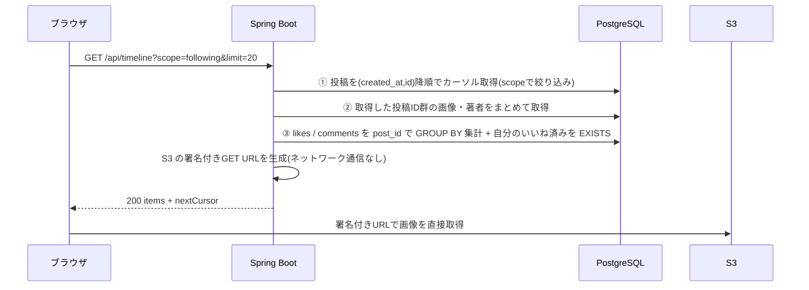

# F-TL 機能定義書: タイムライン

[← 機能一覧](../02-features.md) / [要件定義書](../01-requirements.md)

## 1. 概要
投稿を新しい順に並べて表示する。**「フォロー中」(自分+フォロー中のユーザー)と「全体」(全ユーザー)の2タブ**を持つ。各投稿に**いいね数・コメント数**を表示する。インプレッション数は表示も記録もしない。

| 項目 | 内容 |
|---|---|
| 対象機能 | F-TL-01 フォロー中 / 02 全体 / 03 ページング / 04 投稿カード表示 / 05 投稿詳細表示 |
| 関連画面 | S-03 タイムライン / S-04 投稿詳細 / S-05(投稿一覧部分) |
| 関連API | `GET /api/timeline` / `GET /api/posts/{id}` / `GET /api/users/{id}/posts` |
| 関連テーブル | posts, post_images, comments, likes, follows, users |
| 権限 | ログイン必須 |

## 2. 入出力項目
### タイムライン取得(`GET /api/timeline`)
| パラメータ | 必須 | 内容 |
|---|---|---|
| scope | ○ | `following`(自分+フォロー中)または `all` |
| cursor | - | 前回応答の `nextCursor`。省略で先頭から |
| limit | - | 1〜50、既定 20 |

### 応答
```json
{
  "items": [
    {
      "id": 101,
      "body": "今日はいい天気ですね",
      "createdAt": "2026-10-16T09:00:00Z",
      "author": { "id": 7, "username": "hanako", "displayName": "佐藤花子", "avatarUrl": "https://…(署名付きURL)" },
      "images": [ { "url": "https://…(署名付きURL)", "sortOrder": 0 } ],
      "likeCount": 12,
      "commentCount": 3,
      "likedByMe": true
    }
  ],
  "nextCursor": "eyJ0IjoiMjAyNi0xMC0xNlQwOTowMDowMFoiLCJpIjoxMDF9"
}
```
`nextCursor` は最後の項目の `(createdAt, id)` を符号化した文字列。次がなければ `null`。**閲覧数・インプレッションに当たる項目は含めない**。

## 3. 業務ルール
- 並び順は `created_at` 降順、同時刻は `id` 降順。カーソル方式のため、読み込み中に新しい投稿が増えても重複・欠落しない。
- 削除済み(`deleted_at` あり)の投稿は表示しない(BR-06)。
- **フォロー中**: `user_id = 自分 OR user_id IN (自分のフォロー先)`。フォロー 0 人でも自分の投稿は出る(BR-13)。
- **全体**: 全ユーザーの投稿。
- いいね数・コメント数は削除済みコメントを除いて集計する(BR-08)。
- 画像・アイコンの URL は取得のたびに署名付き GET URL を発行する(有効期限は短時間。例: 15分)。

## 4. 基本フロー

N+1 を避けるため、①〜③は投稿ID群に対する一括クエリで行う。

## 5. 画面仕様(S-03 / S-04)
- タブの既定は「フォロー中」。切替時は先頭から再取得。
- 無限スクロール: 一覧の末尾に近づくと `nextCursor` で次ページを自動取得する。`nextCursor` が `null` になったら止める。失敗時は自動取得を止め、「もっと見る」で再試行。
- 新着バナー: 30秒ごとに先頭ページ(`cursor` なし)を取得する。表示中の最大 `id` より大きい投稿があれば「N件の新しい投稿を表示」を出し、クリックで先頭へ追加する(専用APIは設けず、ポーリングで実現)。新着が 1 ページ分(20件)以上のときは、取得できていない新着が出るため、クリックで追加せず一覧を先頭から取得し直して置き換える(続きは無限スクロールで読み込む。取り直しに失敗したときはエラーを表示し、バナーと表示中の一覧を保持する)。タブ非表示中は取得しない。投稿の削除・編集の他ユーザー分は、再読み込みまで反映しない。
- 「フォロー中」が空のときは、ユーザー検索(S-07)への案内を表示。
- 投稿者のアイコン・表示名・@ユーザーIDはクリックで S-05(F-SEARCH-03)。
- 投稿詳細(S-04): `GET /api/posts/{id}` で 1 件を取得。コメント一覧は F-CMT。存在しない/削除済みは 404。

## 6. 代替・異常フロー
| 条件 | 結果 |
|---|---|
| `scope` が不正 | 400 |
| `cursor` が不正(改ざん等) | 400 |
| `limit` が範囲外 | 400 |
| 未ログイン | 401 |
| 取得に失敗 | 画面に「しばらくしてから再度お試しください」と再読み込みボタン |

## 7. 受入条件
- [ ] 「全体」には全ユーザーの投稿が、「フォロー中」には自分とフォロー中の人の投稿だけが出る
- [ ] フォローを解除すると、「フォロー中」からその人の投稿が消える(再取得後)
- [ ] 21件以上あるとき、末尾までスクロールすると続きが重複なく自動で追加され、全件読み込み後は止まる
- [ ] 他のユーザーが投稿すると、30秒以内にバナーに件数が出て、クリックで先頭に追加される(自分の投稿・表示済みの投稿は件数に含まれない)。20件以上の新着では、クリックで一覧が先頭から取得し直され、新着が欠けない
- [ ] 投稿を削除すると一覧・詳細から消える
- [ ] 各投稿にコメント数・いいね数が表示される。インプレッション数はどこにも表示されない
- [ ] 1ページの取得で発行される SQL が投稿数に比例して増えない(N+1 がない)
